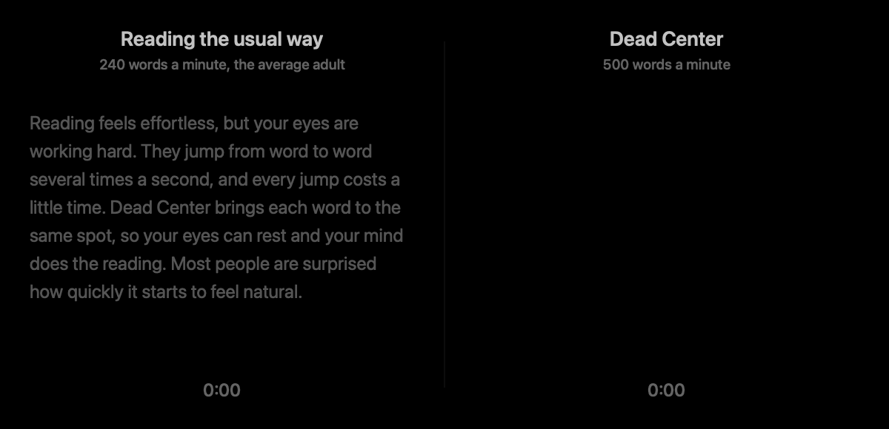
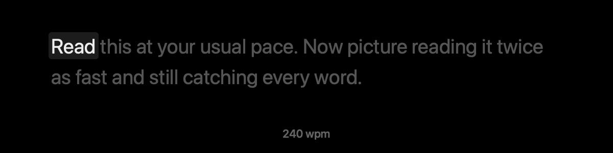
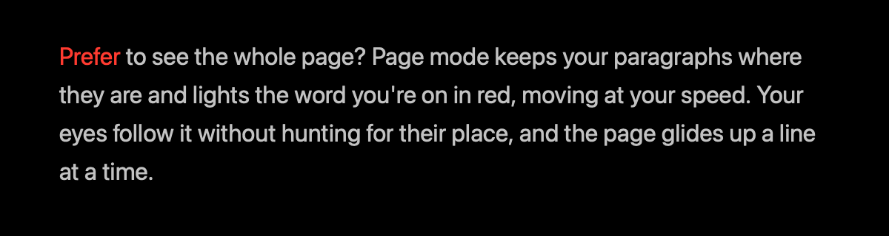

<p align="center">
  
</p>

<h1 align="center">Dead Center</h1>

<p align="center">
  <b>Read twice as fast. Your eyes never have to move.</b>
</p>

<p align="center">
  <a href="https://github.com/Mason363/DeadCenter/releases/latest"><b>Download for macOS</b></a>
  &nbsp;·&nbsp; macOS 14 or later &nbsp;·&nbsp; Free and open source
</p>

<p align="center">
  
</p>

<p align="center"><sub>The same paragraph, read two ways. Dead Center is done in half the time.</sub></p>

## Why it works

When you read a page, your eyes don't glide. They jump from word to word several times a second, and hunt for the start of every new line. All that jumping adds up.

Dead Center brings the words to you instead. Each one lands in exactly the same spot, lined up on the letter your eye goes to naturally, marked in red. There's nothing to chase and nothing to find. Your eyes rest, and your mind does the reading.

## How fast can you go?

The average adult reads about [240 words a minute](https://doi.org/10.1016/j.jml.2019.104047). Here's where you could be.

**240 wpm.** Reading the usual way.



**450 wpm.** Nearly twice the average, and most people are comfortable here within a few sessions.


**700 wpm.** Almost three times the average. If you can keep up with this, you might have a hidden talent.


**1,000 wpm.** Show-off territory. Great for skimming, and for things you've read before.


| Your speed | A 300-page book |
| --- | --- |
| 240 wpm, the average | 6 hours 15 minutes |
| 450 wpm | 3 hours 20 minutes |
| 700 wpm | 2 hours 10 minutes |
| 1,000 wpm | 1 hour 30 minutes |

Your speed is a promise. Dead Center never goes faster than you set it. It only takes a breath at the end of a sentence, on a long word, or for a picture, so even fast speeds feel natural. Start around 300 and nudge it up when it feels easy.

## Two ways to read

**Focus.** One word at a time, dead center. Quotes, brackets and dashes fall away, so every word reads at a glance.

**Page.** Your paragraphs just as they're written, with the word you're on lit in red and moving at your speed.



Switch any time with <kbd>Tab</kbd>, or the Focus · Page switch at the bottom of the reader.

## Read anything

- **Anything you select.** Select text in any app and press <kbd>⌥</kbd><kbd>⌘</kbd><kbd>.</kbd>
- **Web pages.** Just the article, without the menus and ads.
- **Books and documents.** PDF (even scanned ones), EPUB, Word, Markdown and more, with their pictures.
- **Pasted text.** Chat answers, notes and math read as clean prose, never as `**markup**`.
- **Textbooks and papers.** Photograph a page with your iPhone. Columns come out in order, and figures stay as pictures.
- **Images.** The words in screenshots and photos.
- **Speech.** Meetings, lectures and recordings, transcribed on your Mac and ready to read.

## Works with Claude

Ask Claude to send something to Dead Center, or let it decide. When it writes you something long, like an explanation, a summary or study notes, it can open it right in the reader, or save it to your Library for later.

> *"Explain how vaccines train the immune system, and send it to Dead Center."*

To set it up, open Settings ▸ Assistants in Dead Center and click **Connect** next to Claude or Claude Code. That's it. Assistants can only hand Dead Center something to read. They can't see your library or what you've read.

<details>
<summary><b>Other AI apps</b></summary>

<br>

Dead Center includes an MCP server, so any app that supports the Model Context Protocol can use it. In Settings ▸ Assistants, click **Copy** to install the server and copy its path, then add it to your app's MCP settings:

```json
{
  "mcpServers": {
    "dead-center": {
      "command": "/Users/you/Library/Application Support/Dead Center/Assistants/dead-center-mcp"
    }
  }
}
```

It offers three tools. Each can open the reading now or save it for later.

| Tool | What it reads |
| --- | --- |
| `read_text` | Text the assistant wrote. Markdown and LaTeX become clean prose. |
| `read_web_page` | A web article, fetched by Dead Center. |
| `read_file` | A document on your Mac: PDF, EPUB, Word, images and more. |

</details>

## Made to disappear


- Lives in your menu bar. One shortcut works from anywhere.
- Pause, and the whole sentence is there. Swipe to move through it.
- Picks up where you left off, in everything you read.
- Full screen, your fonts, your colors.

## Private

Everything happens on your Mac, including scanning pages and transcribing speech. No account, no tracking, and nothing you read or say is uploaded.

## Get it

1. Download Dead Center from the [latest release](https://github.com/Mason363/DeadCenter/releases/latest).
2. Drag it to Applications and open it.
3. Allow Accessibility when asked, so it can read the text you select.

<details>
<summary><b>Scanning pages</b> (optional)</summary>

<br>

Turn on Settings ▸ General ▸ Page Scans. Then choose **Scan Pages…** from the menu bar icon and use your iPhone's camera, or drop in photos and scans. Your iPhone needs to be nearby and signed in to the same Apple Account.

</details>

<details>
<summary><b>Browser extensions</b> (optional)</summary>

<br>

The shortcut works in every browser without an extension. With one, it reads the article on the page you're looking at, including pages you're signed in to. In Dead Center, open Settings ▸ Browsers and click **Set Up…** next to your browser.

- **Chrome, Brave, Edge, Arc.** Turn on Developer mode on the page that opens, then drag in the `Chrome` folder that appears in Finder.
- **Zen and Firefox.** In `about:config`, set `xpinstall.signatures.required` to `false`, then click Add.
- **Safari.** Turn on Dead Center in Safari ▸ Settings ▸ Extensions.

</details>

<details>
<summary><b>Build it yourself</b></summary>

<br>

You need Xcode and [XcodeGen](https://github.com/yonaskolb/XcodeGen).

```sh
xcodegen generate && open DeadCenter.xcodeproj
```

</details>

## License

[GPL-3.0](LICENSE) © 2026 Mason Chen
