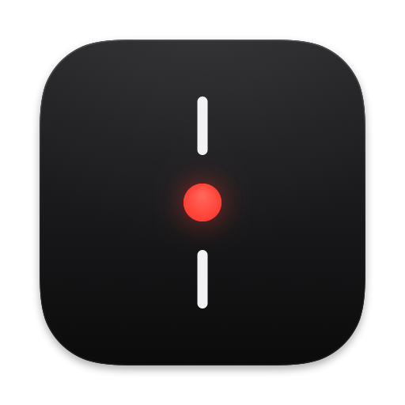
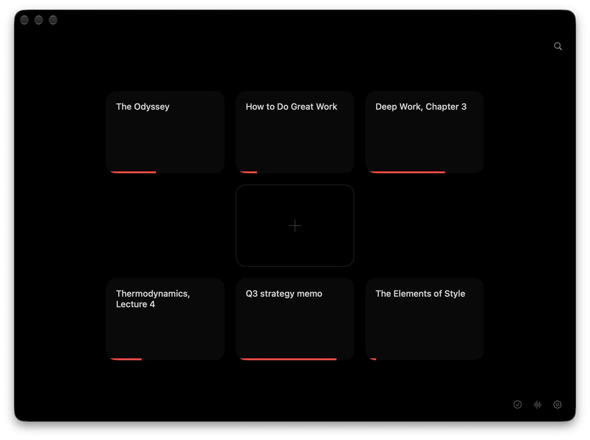

<p align="center">
  
</p>

<h1 align="center">Dead Center</h1>

<p align="center">
  <b>Read anything on your Mac, faster, without moving your eyes.</b>
</p>

<p align="center">
  <a href="https://github.com/Mason363/DeadCenter/releases/latest"><b>Download for macOS</b></a>
  &nbsp;·&nbsp; macOS 14 or later &nbsp;·&nbsp; Free and open source
</p>

<p align="center">
  
</p>

## Why it works

When you read a page, your eyes don't glide. They jump from word to word several times a second, and hunt for the start of every new line.

Dead Center brings the words to your eyes instead. Each one lands in exactly the same place, lined up on the letter your eye naturally goes to, marked in red. There's nothing to chase and nothing to find. You just read.

## Find your speed

The average adult reads about [240 words a minute](https://doi.org/10.1016/j.jml.2019.104047). Here's the same sentence at three speeds.

**250 wpm.** Your everyday pace, with nothing to do but read.


**450 wpm.** Brisk, and easy after a few sessions.


**700 wpm.** Fast. Great for skimming and for things you know well.


| Speed | A 300-page book |
| --- | --- |
| 250 wpm | about 6 hours |
| 450 wpm | about 3 hours 20 minutes |
| 700 wpm | about 2 hours 10 minutes |

Your speed is a promise. Dead Center never goes faster than you set it. It only takes a breath, at the end of a sentence, on a long word, or for a picture, so even fast speeds feel natural. Start around 300 and nudge it up as it gets easy.

## Read anything

- **Anything you select.** Select text in any app and press <kbd>⌥</kbd><kbd>⌘</kbd><kbd>.</kbd>
- **Web pages.** Just the article, without the menus and ads.
- **Books and documents.** PDF (even scanned ones), EPUB, Word, Markdown and more, with their pictures.
- **Pasted text.** Chat answers, notes and math read as clean prose, never as `**markup**`.
- **Images.** The words in screenshots and photos.
- **Textbooks and papers.** Photograph a page with your iPhone. Columns come out in order, and figures stay as pictures.
- **Speech.** Meetings, lectures and recordings, transcribed on your Mac and ready to read.
- **Your AI assistant.** Claude can send what it writes straight to Dead Center, to read now or save for later.

## Made to disappear



- Two ways to read: one word at a time, or the whole page with your word lit in red.
- Lives in your menu bar. One shortcut works from anywhere.
- Pause, and the whole sentence is there. Swipe to move through it.
- Picks up where you left off, in everything you read.
- Full screen, your fonts, your colors.

## Private

Everything happens on your Mac. No account, no tracking, and nothing you read or say is uploaded.

## Get it

1. Download Dead Center from the [latest release](https://github.com/Mason363/DeadCenter/releases/latest).
2. Drag it to Applications and open it.
3. Allow Accessibility when asked, so it can read the text you select.

<details>
<summary><b>Browser extensions</b> (optional)</summary>

<br>

The shortcut works in every browser without an extension. With one, it reads the article on the page you're looking at, including pages you're signed in to. In Dead Center, open Settings ▸ Browsers and click **Set Up…** next to your browser.

- **Chrome, Brave, Edge, Arc.** Turn on Developer mode on the page that opens, then drag in the `Chrome` folder that appears in Finder.
- **Zen and Firefox.** In `about:config`, set `xpinstall.signatures.required` to `false`, then click Add.
- **Safari.** Turn on Dead Center in Safari ▸ Settings ▸ Extensions.

</details>

<details>
<summary><b>AI assistants</b> (optional)</summary>

<br>

In Dead Center, open Settings ▸ Assistants and click **Connect** next to Claude or Claude Code. Any other app that supports MCP can use the server command shown there. Assistants can only hand Dead Center something to read. They can't see your library.

</details>

<details>
<summary><b>Build it yourself</b></summary>

<br>

You need Xcode and [XcodeGen](https://github.com/yonaskolb/XcodeGen).

```sh
xcodegen generate && open DeadCenter.xcodeproj
```

</details>

## License

[GPL-3.0](LICENSE) © 2026 Mason Chen
